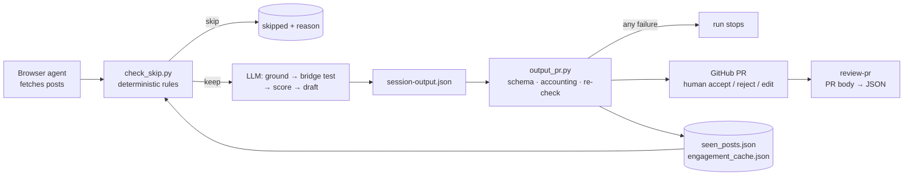

# x-engagement-agent

An AI agent that finds developer conversations on X, decides whether it has anything worth adding, drafts a reply, and opens a **GitHub PR** so a human approves every word before it's posted.

> Clean-room rewrite of a system I built and ran in a previous role (900+ review sessions over about 10 months of internal use). Same architecture, rewritten from scratch. No original code, prompts or data are included; product names and keywords are placeholders.

## The problem

Engaging developers on X was manual, inconsistent, and depended on one person. The obvious fix, "let an LLM reply," is how brands end up posting confident nonsense in public. I needed a system where the agent does the legwork and **can't** ship anything that hasn't passed code checks and a human.

## How it works



| Step | Who | File |
|---|---|---|
| Orchestrate | Agent | [`.pochi/skills/run-engagement-session`](.pochi/skills/run-engagement-session/SKILL.md) |
| Fetch posts | Agent + browser | [`.pochi/skills/fetch-engage`](.pochi/skills/fetch-engage/SKILL.md) |
| Cheap filter | **Code** | [`scripts/check_skip.py`](scripts/check_skip.py) |
| Judge + draft | Agent | [`.pochi/skills/engage-criteria`](.pochi/skills/engage-criteria/SKILL.md), [`product-info`](.pochi/skills/product-info/SKILL.md) |
| Validate + dedup + write + open PR | **Code** | [`scripts/output_pr.py`](scripts/output_pr.py) |
| Memory | **Code** | [`scripts/state.py`](scripts/state.py) |
| Approve | Human, in the PR | [`.pochi/skills/qa-checklist`](.pochi/skills/qa-checklist/SKILL.md) |
| Sync decisions back | Agent | [`.pochi/skills/review-pr`](.pochi/skills/review-pr/SKILL.md) |

Same file, skill and JSON field names as the original; only the product-specific content is replaced with placeholders.

## Design decisions

**1. LLM output is untrusted input.** The agent writes a JSON session file, and nothing downstream reads it until it parses against strict Pydantic models (top of [`output_pr.py`](scripts/output_pr.py)): score 1–10, reply ≤ 280 chars, required reasoning fields. One malformed post fails the whole run, loudly.

**2. Schemas shape the reasoning, not just the output.** The model must fill `grounding_analysis` (what is the author actually saying?) and a `bridge_test_analysis` (is there an *honest* connection to what we know?) before `chosen_reply`. When a reply is bad, the reviewer can see which step was skipped instead of guessing from fluent text.

**3. Cheap, deterministic filters first; LLM for nuance only.** Keyword, crowding, freshness and author rules (not today, not yesterday, max 3 per 7 days) run in code before any LLM call. They're fast, free and testable. The LLM only judges what rules can't (is this really about our domain?).

**4. Don't trust the agent to follow its own instructions.** The agent is *told* to run the skip filter on every post. In practice agents sometimes don't. So `output_pr.py` re-applies the dedup and author-cap rules in code against on-disk state, moves anything that slipped through to `skipped_posts`, and flags it in the PR so the reviewer sees the agent erred.

**5. Accounting check.** `engaged + skipped` must equal `posts_analyzed`. A mismatch means the agent dropped or invented posts, so the session is rejected rather than half-trusted.

**6. State fails loudly and writes atomically.** A corrupt state file stops the run: silently resetting to empty would make the agent forget its history and re-engage the same people, the most embarrassing failure possible in public. Writes go through tmp-file + `os.replace`, so a crash can't create that corruption in the first place. Memory is pruned on a TTL so it can't grow forever.

**7. A PR is the review UI.** Reviewers already live in GitHub. Inline edits, comments and merge history give an audit trail of every reply and who approved it, with no custom dashboard to build or maintain. After review, the PR body is the source of truth and is synced back into the JSON.

**8. Skip is the default.** A missed reply costs nothing; a bad one costs trust. The bar: *would a senior engineer reading this learn something concrete?*

## How the original evolved

The original ran for about 10 months (900+ review sessions, each a PR approved by a teammate). This rewrite is what that history taught me. The pattern: **I started by trusting the agent to run everything, and almost every major change after that moved a responsibility out of the prompt and into code.**

| Phase | What I tried | What broke | What changed |
|---|---|---|---|
| **1. Prompt only** | Engagement criteria and scoring written as agent instructions; the agent ran the whole session | Inconsistent output formats; the agent said a post was recorded in the duplicate list when it wasn't | Moved recording into a script |
| **2. Shell scripts** | A bash filter script the agent called per post | Untrusted post text passed through the shell; quoting and concurrency bugs; macOS/Linux differences | Rewrote the automation in Python |
| **3. State in git** | Memory files committed alongside session outputs | Merge conflicts between parallel session branches | Memory became local to the operator |
| **4. Checks that wrote** | The filter also updated memory | Posts that were only *looked at* got treated as engaged | Checks became read-only; memory updates once, at the end |
| **5. Validation** | Trusting the agent's JSON | Missing or wrongly typed fields reached review | Schema validation and a count check before any PR |
| **6. Quality from review** | More posts per session | Weak replies | A per-session cap, a "bridge test" for an honest connection, reasoning-first scoring, criteria tightened from reviewer edits |
| **7. Hand-off** | Only I could run it | — | Config-driven rules and an operator runbook |

**Experiments I rolled back:** extra context retrieval made sessions less reliable. I disabled it and brought it back only as optional and fail-safe.

**Gaps that survived into the original** (and what this rewrite does about them):
- The early filter treated a corrupt memory file as empty. → Fails loudly in both places.
- Memory files were written in place. → Written to a temp file, then swapped in atomically.
- Score and "bridge test" were only asked for in the prompt. → Enforced in code.
- A cap of 5 per session later became a quota of exactly 5, which pressured the agent into weak picks. → A cap only.
- **Still open, here too:** review decisions are synced back by an agent, not parsed by code; the early and final checks don't share one rules function (`output_pr` doesn't repeat the today/yesterday author rule); post text still reaches the filter through a shell `echo` in the skill instructions.

## Run it

```bash
cp config/config.template.toml config/config.toml

# filter one post (run.sh creates .venv and installs requirements on first run)
echo '{"link":"https://x.com/u/status/1","author":"@u","content":"...","reply_count":4}' \
  | ./run.sh -m scripts.check_skip

# validate + write outputs/, logs/ and the PR body (add --finalize to open the PR)
cp examples/session-output.json .
./run.sh -m scripts.output_pr --session-data-file session-output.json

./run.sh -m pytest -q
```

Note: a dry run (without `--finalize`) still records the proposals in `seen_posts.json`, so running the example twice shows cross-session dedup.

The agent side runs in [Pochi](https://github.com/TabbyML/pochi) (or any coding agent with a browser tool and shell access). Start from [`.pochi/skills/run-engagement-session`](.pochi/skills/run-engagement-session/SKILL.md).

## What I'd do next

- **Close the feedback loop automatically:** cluster reviewer rejections and edits, and propose changes to the criteria prompt and filter config.
- **Replace JSON files with SQLite** once more than one operator runs sessions concurrently.
- **Eval set:** a fixed batch of labelled posts to score prompt changes before shipping them, instead of judging by feel.
